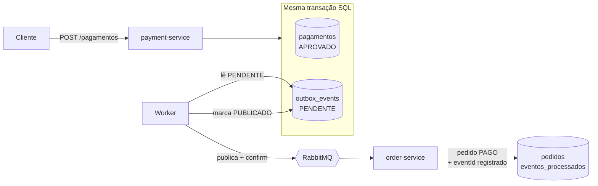

# Transactional Outbox — Spring Boot, PostgreSQL e RabbitMQ


POC do padrão **Transactional Outbox** aplicado a um fluxo de pagamento PIX entre dois microsserviços: o `payment-service` aprova o pagamento e o `order-service` marca o pedido como pago.

> Quando o RabbitMQ falha, o evento não pode desaparecer.

## O problema: dual write

Ao aprovar um pagamento, o `payment-service` precisa fazer duas coisas:

1. gravar o pagamento no PostgreSQL;
2. avisar o `order-service` pelo RabbitMQ.

São dois sistemas sem uma transação em comum, então um pode dar certo e o outro não:

- **Banco salva, publicação falha:** o cliente pagou e o pedido nunca vira `PAGO`.
- **Publicação sai, commit falha:** o pedido vira `PAGO` sem existir pagamento.

Colocar o `rabbitTemplate.send(...)` dentro de um método `@Transactional` não resolve: o `@Transactional` controla só o banco. Se o commit falhar depois do envio, o banco faz rollback, mas a mensagem já foi entregue.

## A solução

O evento é gravado numa tabela `outbox_events`, no **mesmo banco e na mesma transação** do pagamento. Ou os dois existem, ou nenhum. Publicar no RabbitMQ vira uma tarefa separada, feita por um worker que lê a outbox.



## Stack

Java 21 · Spring Boot 4 · Spring Data JPA · PostgreSQL 16 · Flyway · RabbitMQ · Docker Compose · JUnit 5 · Testcontainers

## Como funciona

### 1. Gravação atômica (`payment-service`)

`PagamentoService.aprovar()` salva o pagamento e o evento `PagamentoAprovado` na outbox dentro de um único `@Transactional`. Nenhuma chamada ao RabbitMQ acontece aqui.

O `id` do registro na outbox vai no payload como `eventId` e acompanha o evento até o consumidor.

### 2. Publicação assíncrona (`OutboxPublisher`)

A cada 2 segundos, o worker:

- busca os eventos `PENDENTE` com `FOR UPDATE SKIP LOCKED`, para que múltiplas instâncias não publiquem o mesmo evento;
- publica no exchange `pagamentos.exchange`, com o `eventId` também como `messageId`;
- aguarda o **publisher confirm** do broker e só então marca o evento como `PUBLICADO`.

Se o broker estiver fora, o evento continua `PENDENTE` e é tentado de novo no próximo ciclo. Um índice parcial (`WHERE status = 'PENDENTE'`) mantém essa consulta rápida mesmo com a tabela cheia.

### 3. Consumo idempotente (`order-service`)

A entrega é **at-least-once**: o mesmo evento pode chegar mais de uma vez (por exemplo, se o worker cair entre o ack do broker e o commit do status). Por isso o consumidor, numa única transação:

- verifica se o `eventId` já está em `eventos_processados`; se estiver, ignora;
- caso contrário, marca o pedido como `PAGO` e registra o `eventId`.

A chave primária em `event_id` cobre entregas simultâneas: se duas passarem pela verificação ao mesmo tempo, só um `INSERT` é aceito e a outra transação é desfeita por completo.

Eventos de pedidos inexistentes são rejeitados com `AmqpRejectAndDontRequeueException`, evitando loop infinito de reentrega.

### 4. Limpeza da outbox

Um job agendado (`OutboxCleanupJob`) remove eventos `PUBLICADO` mais antigos que a janela de retenção, em lotes, cada um na sua própria transação. Eventos `PENDENTE` nunca são apagados, independentemente da idade.

```yaml
outbox:
  limpeza:
    cron: "0 0 3 * * *"   # diariamente às 3h
    retencao: 7d
    tamanho-lote: 1000
```

## As garantias, na prática

**O evento sobrevive ao broker fora do ar.** RabbitMQ parado durante a publicação, depois reiniciado:

```
WARN  OutboxPublisher : Falha ao publicar o evento cbfeb744-...: java.io.IOException. Nova tentativa no próximo ciclo.
INFO  CachingConnectionFactory : Attempting to connect to: [localhost:5672]
WARN  OutboxPublisher : Falha ao publicar o evento cbfeb744-...: java.io.IOException. Nova tentativa no próximo ciclo.
INFO  CachingConnectionFactory : Created new connection: rabbitConnectionFactory#25fb43a9 ...
INFO  OutboxPublisher : Evento cbfeb744-... publicado
```

**Evento duplicado não causa efeito colateral.** O mesmo evento republicado; o consumidor reconhece e ignora:

```
[payment-service] OutboxPublisher : Evento 0cc97b4d-... publicado
[order-service]   PedidoService   : Evento 0cc97b4d-... já processado, ignorando
```

**Sem a transação, a inconsistência aparece.** Durante o desenvolvimento, uma falha simulada após as duas escritas, sem `@Transactional`, deixou o pagamento gravado como `APROVADO` mesmo com a operação falhando. Com a anotação, nenhum registro foi salvo.

## Testes

As três garantias são cobertas por testes de integração com Testcontainers (PostgreSQL e RabbitMQ reais):

| Teste | Garantia |
|---|---|
| `naoDeveSalvarPagamentoQuandoGravacaoDoEventoFalha` | atomicidade entre pagamento e evento |
| `deveManterEventoPendenteQuandoBrokerEstaForaEPublicarQuandoVoltar` | o evento não se perde |
| `devePublicarEventoComIdDaOutboxComoMessageId` | a mensagem chega com o ID usado na idempotência |
| `deveProcessarEventoDuplicadoApenasUmaVez` | idempotência no consumidor |
| `deveDescartarEventoDePedidoInexistenteSemRegistrarComoProcessado` | tratamento de poison message |

Nos testes, o agendamento é desligado (`outbox.agendamento.habilitado=false`) e o worker é acionado manualmente, para que o resultado não dependa de timing.

## Como rodar

Pré-requisitos: Java 21 e Docker.

```bash
# infraestrutura
docker compose up -d

# serviços (em terminais separados)
cd payment-service && ./mvnw spring-boot:run   # porta 8081
cd order-service   && ./mvnw spring-boot:run   # porta 8082
```

Fluxo completo:

```bash
# 1. criar um pedido
curl -X POST localhost:8082/pedidos \
  -H "Content-Type: application/json" -d '{"valor": 150.00}'

# 2. aprovar o pagamento usando o id retornado
curl -X POST localhost:8081/pagamentos \
  -H "Content-Type: application/json" \
  -d '{"pedidoId": "<ID_DO_PEDIDO>", "valor": 150.00}'

# 3. consultar o pedido (status PAGO em até ~2s)
curl localhost:8082/pedidos/<ID_DO_PEDIDO>
```

Painel do RabbitMQ: http://localhost:15672 (guest/guest).

Testes:

```bash
cd payment-service && ./mvnw test
cd order-service   && ./mvnw test
```

## Trade-offs

- **Latência:** o evento chega com até ~2s de atraso (o intervalo do polling), em troca de nunca se perder.
- **At-least-once:** duplicatas são possíveis por design; todo consumidor precisa ser idempotente.
- **Carga no banco:** o polling consulta a outbox a cada ciclo, mesmo sem eventos pendentes.
- **Retenção:** guardar eventos publicados facilita auditoria e reprocessamento, mas exige limpeza para a tabela não crescer indefinidamente.

## Próximos passos

- Substituir o polling por **CDC com Debezium**, lendo o WAL do PostgreSQL: menor latência, sem consultas periódicas e sem necessidade de status na outbox.
- **Dead Letter Queue** para eventos rejeitados, em vez de descartá-los.
- Métricas de eventos pendentes e idade do evento mais antigo, para alertar quando o broker ficar indisponível.
