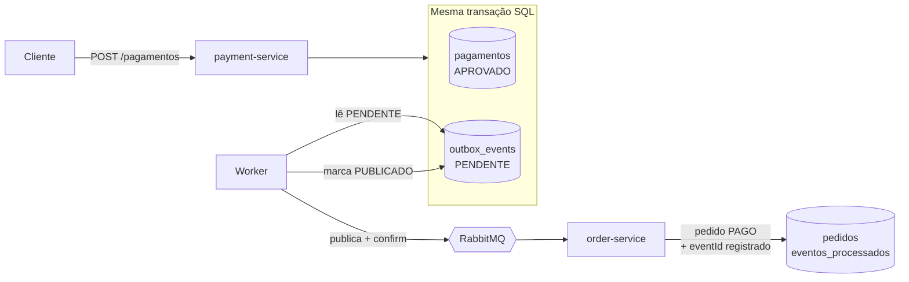
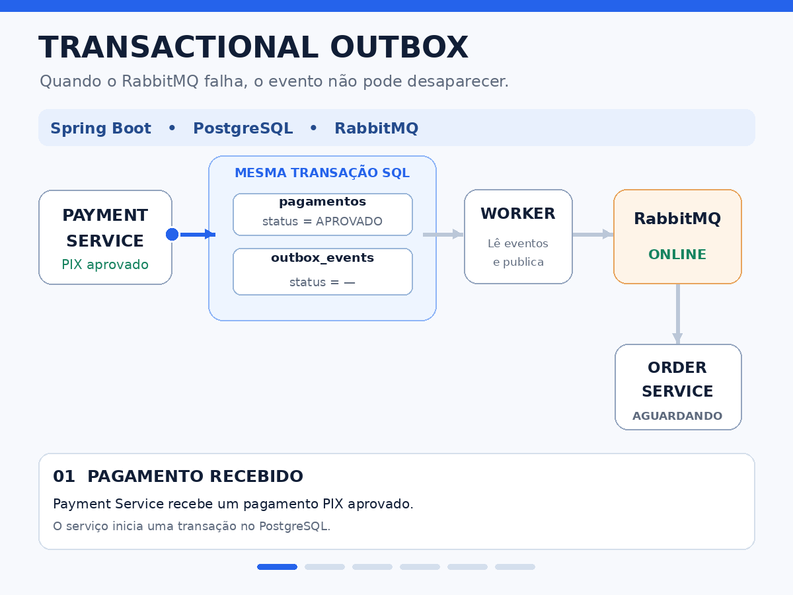
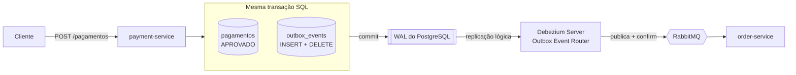

# Transactional Outbox — Spring Boot, PostgreSQL, RabbitMQ e Debezium


POC do padrão **Transactional Outbox** aplicado a um fluxo de pagamento PIX entre dois microsserviços: o `payment-service` aprova o pagamento e o `order-service` marca o pedido como pago.

O projeto implementa as duas formas de levar o evento até o broker, selecionáveis por configuração:

- **Parte 1 — polling:** um worker consulta a tabela de outbox periodicamente.
- **Parte 2 — CDC com Debezium:** o evento é capturado direto do WAL do PostgreSQL.

> Quando o RabbitMQ falha, o evento não pode desaparecer.

## O problema: dual write

Ao aprovar um pagamento, o `payment-service` precisa fazer duas coisas:

1. gravar o pagamento no PostgreSQL;
2. avisar o `order-service` pelo RabbitMQ.

São dois sistemas sem uma transação em comum, então um pode dar certo e o outro não:

- **Banco salva, publicação falha:** o cliente pagou e o pedido nunca vira `PAGO`.
- **Publicação sai, commit falha:** o pedido vira `PAGO` sem existir pagamento.

Colocar o `rabbitTemplate.send(...)` dentro de um método `@Transactional` não resolve: o `@Transactional` controla só o banco. Se o commit falhar depois do envio, o banco faz rollback, mas a mensagem já foi entregue.

## A solução

O evento é gravado numa tabela `outbox_events`, no **mesmo banco e na mesma transação** do pagamento. Ou os dois existem, ou nenhum. Publicar no RabbitMQ vira uma tarefa separada: na parte 1, um worker que lê a outbox; na parte 2, o Debezium lendo o WAL.



## Stack

Java 21 · Spring Boot 4 · Spring Data JPA · PostgreSQL 16 · Flyway · RabbitMQ · Debezium Server 3.3 · Docker Compose · JUnit 5 · Testcontainers

## Parte 1: polling



### 1. Gravação atômica (`payment-service`)

`PagamentoService.aprovar()` salva o pagamento e o evento `PagamentoAprovado` na outbox dentro de um único `@Transactional`. Nenhuma chamada ao RabbitMQ acontece aqui.

O `id` do registro na outbox vai no payload como `eventId` e acompanha o evento até o consumidor.

### 2. Publicação assíncrona (`OutboxPublisher`)

A cada 2 segundos, o worker:

- busca os eventos `PENDENTE` com `FOR UPDATE SKIP LOCKED`, para que múltiplas instâncias não publiquem o mesmo evento;
- publica no exchange `pagamentos.exchange`, com o `eventId` também como `messageId`;
- aguarda o **publisher confirm** do broker e só então marca o evento como `PUBLICADO`.

Se o broker estiver fora, o evento continua `PENDENTE` e é tentado de novo no próximo ciclo. Um índice parcial (`WHERE status = 'PENDENTE'`) mantém essa consulta rápida mesmo com a tabela cheia.

### 3. Consumo idempotente (`order-service`)

A entrega é **at-least-once**: o mesmo evento pode chegar mais de uma vez (por exemplo, se o worker cair entre o ack do broker e o commit do status). Por isso o consumidor, numa única transação:

- verifica se o `eventId` já está em `eventos_processados`; se estiver, ignora;
- caso contrário, marca o pedido como `PAGO` e registra o `eventId`.

A chave primária em `event_id` cobre entregas simultâneas: se duas passarem pela verificação ao mesmo tempo, só um `INSERT` é aceito e a outra transação é desfeita por completo.

Eventos de pedidos inexistentes são rejeitados com `AmqpRejectAndDontRequeueException`, evitando loop infinito de reentrega.

### 4. Limpeza da outbox

Um job agendado (`OutboxCleanupJob`) remove eventos `PUBLICADO` mais antigos que a janela de retenção, em lotes, cada um na sua própria transação. Eventos `PENDENTE` nunca são apagados, independentemente da idade.

```yaml
outbox:
  limpeza:
    cron: "0 0 3 * * *"   # diariamente às 3h
    retencao: 7d
    tamanho-lote: 1000
```

## Parte 2: CDC com Debezium

A parte 1 resolve o problema, mas o worker consulta a tabela a cada ciclo, mesmo sem eventos, e a outbox precisa de limpeza. A parte 2 troca **apenas o transporte**: a gravação atômica e o consumidor idempotente continuam idênticos. O `order-service` não teve nenhuma linha alterada.



### Como funciona

Todo commit no PostgreSQL é registrado primeiro no **WAL** (Write-Ahead Log). Com `wal_level=logical`, o Debezium se conecta como uma réplica, por meio de um **slot de replicação**, e recebe cada alteração commitada na `outbox_events`. Isso é **CDC (Change Data Capture)**: o banco avisa o que mudou, em vez de alguém perguntar a cada 2 segundos.

O **Outbox Event Router** do Debezium transforma cada `INSERT` na outbox em uma mensagem contendo apenas o `payload`, publicada no mesmo exchange e routing key usados na parte 1.

### A tabela sempre vazia

O Debezium lê o histórico (o WAL), não o estado da tabela. Por isso, no modo `debezium`, o evento é **inserido e apagado na mesma transação**:

```java
@Transactional(propagation = Propagation.MANDATORY)
public void registrar(OutboxEvent evento) {
    if (!modoDebezium) {
        repository.save(evento);          // o worker lê depois
        return;
    }
    OutboxEvent salvo = repository.saveAndFlush(evento); // INSERT vai para o WAL
    repository.delete(salvo);                            // DELETE no commit
}
```

- O `INSERT` fica no WAL e é publicado; o `DELETE` é ignorado pelo Event Router. A tabela termina vazia, sem coluna de status e sem job de limpeza.
- O **`saveAndFlush` é obrigatório**. Com `save` + `delete` antes de um flush, o Hibernate cancela as duas operações, nenhum SQL é executado e o evento nunca chega ao WAL: o pagamento é salvo e nenhum evento sai.
- **`Propagation.MANDATORY`** impede que o método seja chamado fora de uma transação, o que quebraria a atomicidade silenciosamente.
- Se a transação falhar, nem o `INSERT` nem o `DELETE` chegam ao WAL, e nenhum evento é publicado.

### Configuração

O modo é escolhido no `application.yml` do `payment-service`. No modo `debezium`, o `OutboxPublisher` nem é criado (`@ConditionalOnProperty`).

```yaml
outbox:
  publicacao:
    modo: debezium   # polling | debezium
```

O Debezium Server roda no Docker Compose, configurado em [`debezium/application.properties`](debezium/application.properties). Os pontos principais:

| Configuração | Por quê |
|---|---|
| `wal_level=logical` no PostgreSQL | permite a replicação lógica que o Debezium usa |
| `table.include.list=public.outbox_events` | captura só a outbox, não a tabela de pagamentos |
| `snapshot.mode=no_data` | não reenvia linhas que já existiam ao conectar |
| `transforms=outbox` (EventRouter) | publica só o `payload` como corpo da mensagem |
| `table.expand.json.payload=true` | o payload é `TEXT`; sem isso, o JSON sairia como string escapada |
| `sink.type=rabbitmq` + `ackTimeout` | publica no RabbitMQ aguardando o publisher confirm |

### Na prática

Com o worker desligado, o `payment-service` não registra nenhuma publicação; quem leva o evento é o Debezium:

```
[debezium]      CREATE PUBLICATION dbz_publication FOR TABLE "public"."outbox_events"
[debezium]      Creating replication slot ... "debezium" LOGICAL pgoutput
[debezium]      Starting streaming / Processing messages
[order-service] Pedido aa54d02f-... marcado como PAGO (evento 76c0e6e1-...)
```

E a outbox continua vazia depois do fluxo:

```
payment=# select count(*) from outbox_events;
 count
-------
     0
```

### Polling x CDC

| | Polling (parte 1) | CDC com Debezium (parte 2) |
|---|---|---|
| Latência | até o intervalo do ciclo (~2s) | quase imediata |
| Carga no banco | um `SELECT` por ciclo, mesmo sem eventos | lê o WAL, sem consultar a tabela |
| Status na outbox | necessário (`PENDENTE`/`PUBLICADO`) | dispensável |
| Limpeza da tabela | job agendado com retenção | insert + delete na mesma transação |
| Infraestrutura | só a aplicação | um serviço a mais (Debezium Server) |
| Garantia de entrega | at-least-once | at-least-once |
| Consumidor idempotente | necessário | necessário |
| Risco operacional | worker parado acumula linhas na tabela | Debezium parado faz o PostgreSQL reter WAL (disco do banco pode encher) |

## As garantias, na prática

**O evento sobrevive ao broker fora do ar.** RabbitMQ parado durante a publicação, depois reiniciado:

```
WARN  OutboxPublisher : Falha ao publicar o evento cbfeb744-...: java.io.IOException. Nova tentativa no próximo ciclo.
INFO  CachingConnectionFactory : Attempting to connect to: [localhost:5672]
WARN  OutboxPublisher : Falha ao publicar o evento cbfeb744-...: java.io.IOException. Nova tentativa no próximo ciclo.
INFO  CachingConnectionFactory : Created new connection: rabbitConnectionFactory#25fb43a9 ...
INFO  OutboxPublisher : Evento cbfeb744-... publicado
```

**Evento duplicado não causa efeito colateral.** O mesmo evento republicado; o consumidor reconhece e ignora:

```
[payment-service] OutboxPublisher : Evento 0cc97b4d-... publicado
[order-service]   PedidoService   : Evento 0cc97b4d-... já processado, ignorando
```

**Sem a transação, a inconsistência aparece.** Durante o desenvolvimento, uma falha simulada após as duas escritas, sem `@Transactional`, deixou o pagamento gravado como `APROVADO` mesmo com a operação falhando. Com a anotação, nenhum registro foi salvo.

## Testes

As três garantias são cobertas por testes de integração com Testcontainers (PostgreSQL e RabbitMQ reais):

| Teste | Garantia |
|---|---|
| `naoDeveSalvarPagamentoQuandoGravacaoDoEventoFalha` | atomicidade entre pagamento e evento |
| `deveManterEventoPendenteQuandoBrokerEstaForaEPublicarQuandoVoltar` | o evento não se perde |
| `devePublicarEventoComIdDaOutboxComoMessageId` | a mensagem chega com o ID usado na idempotência |
| `deveProcessarEventoDuplicadoApenasUmaVez` | idempotência no consumidor |
| `deveDescartarEventoDePedidoInexistenteSemRegistrarComoProcessado` | tratamento de poison message |

Nos testes, o agendamento é desligado (`outbox.agendamento.habilitado=false`), o modo é fixado em `polling` e o worker é acionado manualmente, para que o resultado não dependa de timing.

## Como rodar

Pré-requisitos: Java 21 e Docker.

```bash
# infraestrutura (PostgreSQL x2, RabbitMQ e Debezium Server)
docker compose up -d

# serviços (em terminais separados)
cd payment-service && ./mvnw spring-boot:run   # porta 8081
cd order-service   && ./mvnw spring-boot:run   # porta 8082
```

Fluxo completo:

```bash
# 1. criar um pedido
curl -X POST localhost:8082/pedidos \
  -H "Content-Type: application/json" -d '{"valor": 150.00}'

# 2. aprovar o pagamento usando o id retornado
curl -X POST localhost:8081/pagamentos \
  -H "Content-Type: application/json" \
  -d '{"pedidoId": "<ID_DO_PEDIDO>", "valor": 150.00}'

# 3. consultar o pedido (status PAGO)
curl localhost:8082/pedidos/<ID_DO_PEDIDO>
```

Painel do RabbitMQ: http://localhost:15672 (guest/guest). Logs do Debezium: `docker compose logs -f debezium`.

Para usar a versão com polling, troque `outbox.publicacao.modo` para `polling` e reinicie o `payment-service` (o Debezium pode ficar parado: `docker compose stop debezium`).

Testes:

```bash
cd payment-service && ./mvnw test
cd order-service   && ./mvnw test
```

## Trade-offs

- **Latência:** no polling, o evento chega com até ~2s de atraso (o intervalo do ciclo); com CDC, praticamente sem atraso.
- **At-least-once:** duplicatas são possíveis por design; todo consumidor precisa ser idempotente.
- **Carga no banco:** o polling consulta a outbox a cada ciclo, mesmo sem eventos pendentes; o CDC não consulta a tabela.
- **Retenção:** no polling, guardar eventos publicados facilita auditoria e reprocessamento, mas exige limpeza. Com CDC a tabela fica vazia, e o histórico passa a depender do broker ou de logs.
- **Operação do CDC:** o Debezium é mais um serviço para monitorar. Se ficar parado, o slot de replicação faz o PostgreSQL reter WAL até ele voltar.

## Próximos passos

- Testes de integração do modo `debezium` (Testcontainers com PostgreSQL em `wal_level=logical` e Debezium Server).
- Monitorar o atraso do slot de replicação (`pg_replication_slots`) e limitar a retenção de WAL (`max_slot_wal_keep_size`).
- **Dead Letter Queue** para eventos rejeitados, em vez de descartá-los.
- Métricas de eventos pendentes e idade do evento mais antigo, para alertar quando o broker ficar indisponível.
